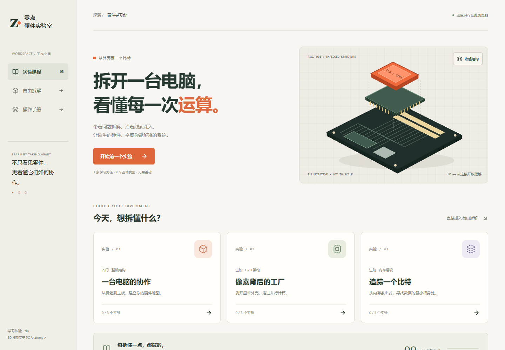
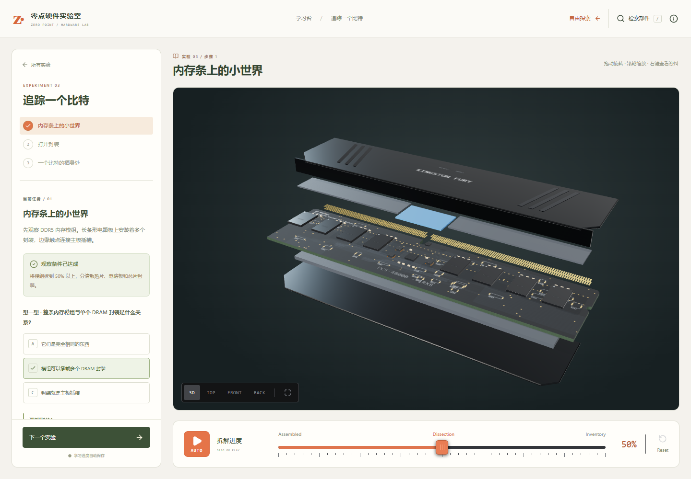

# 零点硬件实验室

一个以「观察 → 拆解 → 理解」为核心的中文硬件学习应用。首页、原创矢量结构示意、三条课程、九个实验、知识检查与学习记录由 zln 设计实现；底层程序化 3D 模型、渲染器和英文部件资料复用 [PC Anatomy](https://github.com/Yoosseph/pc-anatomy)，保留 MIT 许可及 Yoseph 署名。





## 启动

需要 Node.js 22.13 或更新版本，在项目目录运行：

```powershell
npm ci
npm run dev
```

打开终端地址的根路径（默认 http://127.0.0.1:5173/），看到新的中文学习台。`npm run build` 生成 dist/，`npm start` 启动生产预览。浏览器需支持 WebGL，推荐开启图形加速。

## 原创学习体验

- **学习台**：米白、墨绿与橙色视觉，原创可展开的处理器 / 主板 SVG 示意，课程选择与学习日志。
- **一台电脑的协作**：机箱 → 主板 → NVMe，从系统空间组织理解分工。
- **像素背后的工厂**：显卡 → GPU 架构 → SM，区分物理结构和逻辑组织。
- **追踪一个比特**：内存模组 → 封装 → 存储单元，逐层建立尺度概念。
- **互动实验**：依据模型层级和拆解进度解锁知识检查，答错可重试，答对才记录完成；不冒充眼动或阅读检测。
- **学习记录**：保存在当前浏览器，支持复习、继续未完成实验、确认后重置。存储损坏时安全恢复，存储禁用时提示仅暂存当前页面。
- **响应式工作台**：独立滚动的任务面板、始终可见的下一步按钮、手机任务抽屉。

课程链接：`/?lesson=inside`、`/?lesson=graphics`、`/?lesson=memory`。刷新恢复到该路径第一个未完成的实验。打开 `/?scale=sm` 等原有模型链接会进入自由拆解；原有 68 层级、593 条部件资料及对比功能保留。

3D 模型与原项目相同，并非从零自建；原创工作集中在产品界面、交互流程与教学组织。更详细的版权和技术资料见 [LICENSE](LICENSE)、[SOURCES.md](SOURCES.md)、[原始 README](docs/UPSTREAM_README.md)。

## 验证

```powershell
npm run check
npm test
npm run build
npm run size
node scripts/learning-smoke.mjs
```

浏览器脚本默认连接 http://127.0.0.1:4173/ ，运行前执行 `npm start`。默认使用 Windows Edge；其他环境通过 BROWSER_EXECUTABLE 指定浏览器，NOTEBOOK_BASE_URL 指定地址。截图写入被忽略的 output/playwright/learning/。验证范围见 [验证记录](docs/VALIDATION.md)。

## 部署与维护

静态应用，无服务端与 API 密钥。上传整个 dist/ 到网站根路径即可；保留 guide/ 的静态页面。已提供 Vercel 和 Netlify 配置。子路径部署需单独调整 Vite base 与静态链接。

当前没有远程仓库、不推送、不发布；所有节点提交到本地 main，作者为 `zln <zhenglinniao1417@gmail.com>`。上游版本 ace99de7956f741b6bdb70de56d5dc4b4aafb7ae。变更记录见 [开发记录](docs/DEVELOPMENT.md)，架构见 [ARCHITECTURE.md](ARCHITECTURE.md)。继承的英文指南、sitemap 和 robots.txt 仍含上游域名；独立域名发布前需统一更新。新的首页不会使用上游 canonical 或社交站点身份。
