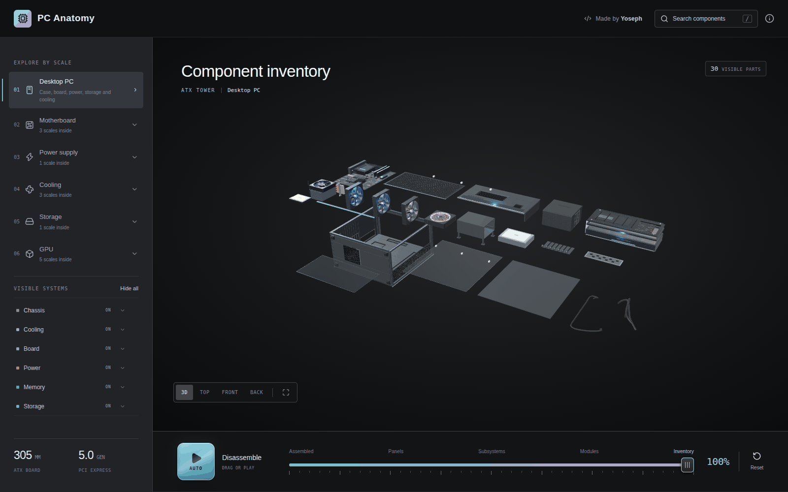

# PC Anatomy · 硬件拆解

基于 [Yoosseph/pc-anatomy](https://github.com/Yoosseph/pc-anatomy) 的完整本地复刻。保留原版深色工作台、程序化 Three.js 模型、逐层拆解、搜索、部件资料、气流、相机、对比模式与深链接；补充中文操作指南和独立静态部署配置。



## 本地启动

需要 Node.js **22.13 或更新版本**。在当前项目目录打开终端：

```powershell
npm ci
npm run dev
```

打开终端打印的地址，默认是 http://127.0.0.1:5173/ 。浏览器需要支持 WebGL，建议开启图形加速。所有模型与材质均由代码在本地生成，无需模型下载或 API 密钥。

```powershell
npm run build
npm start
```

生产预览默认在 http://127.0.0.1:4173/ 。不要双击 dist/index.html，请使用 HTTP 服务器。

## 完整功能

- 台式主机：ATX 机箱、主板、CPU、内存、电源、散热、SATA SSD、NVMe。
- 显卡：RTX 5090、RX 9070 XT、Arc B580，逐级进入逻辑架构。
- 内存：DDR5 / DDR4，从模组到封装、存储阵列和单元。
- 笔记本：Legion 5 与 MacBook Pro，以及各自的硬件分支。
- 三阶段拆解：Assembly → Dissection → Inventory，支持自动播放和手动拖动。
- 同类设备对比、部件隐藏/隔离/聚焦、历史导航与可分享链接。

示例：`/?scale=card` 打开 RTX 5090，`/?scale=pc&open=100` 打开主机零件清单，`/?scale=sm` 进入流式多处理器。顶部「使用指南」进入新增的中文教程，英文技术指南仍保留。部件详情仍为原始英文，未进行全文汉化。

## 验证

```powershell
npm run check
npm test
npm run build
npm run size
```

既有 108 项 Node 测试覆盖目录、层级、几何、装配间距、内存、显卡、笔记本、深链接与对比。现有 CI 在 push / pull request 时执行检查。最新实测记录见 [验证记录](docs/VALIDATION.md)。

## 部署

静态单页应用，产物为 `dist/`，没有服务器和数据库。部署整个目录到网站根路径，确保 `/guide/` 使用自己的 index.html。查询参数形式的深链接无需路由重写。

- Vercel：已提供 vercel.json。
- Netlify：已提供 netlify.toml。
- 其他静态服务器：上传整个 dist/。

当前配置面向域名根路径。子路径部署需另行调整 Vite base 和静态页面链接。独立域名发布前，应同步替换 index.html、public/guide/index.html、scripts/sitemap-urls.ts、public/robots.txt 中的上游 canonical / 社交分享域名，再运行 `node --experimental-strip-types scripts/generate-sitemap.mjs`。这些域名保留用于来源追溯，不表示本地版本已部署到该域名。

当前只交付本地 Git 仓库，没有远程地址，也没有上传或发布。仓库局部作者为 `zln <zhenglinniao1417@gmail.com>`，不修改全局配置。开发按节点提交，见 [开发记录](docs/DEVELOPMENT.md)。

## 来源与维护

- 原项目：[Yoosseph/pc-anatomy](https://github.com/Yoosseph/pc-anatomy)，作者 Yoseph。
- 原项目演示：[pc-anatomy.com](https://pc-anatomy.com/)。
- 基线版本：`ace99de7956f741b6bdb70de56d5dc4b4aafb7ae`，2026-10-19 获取。
- [原始 README](docs/UPSTREAM_README.md)（其中相对链接按原仓库根目录理解）。
- [架构](ARCHITECTURE.md)、[技术来源](SOURCES.md)、[MIT 许可](LICENSE)。

页面内 Created by Yoseph 与上游源码链接用于标明原作。独立版本移除了 Vercel Analytics 运行时集成。物理模型是有来源的示意几何，芯片视图是逻辑架构图，不是精确维修图或晶体管版图。
