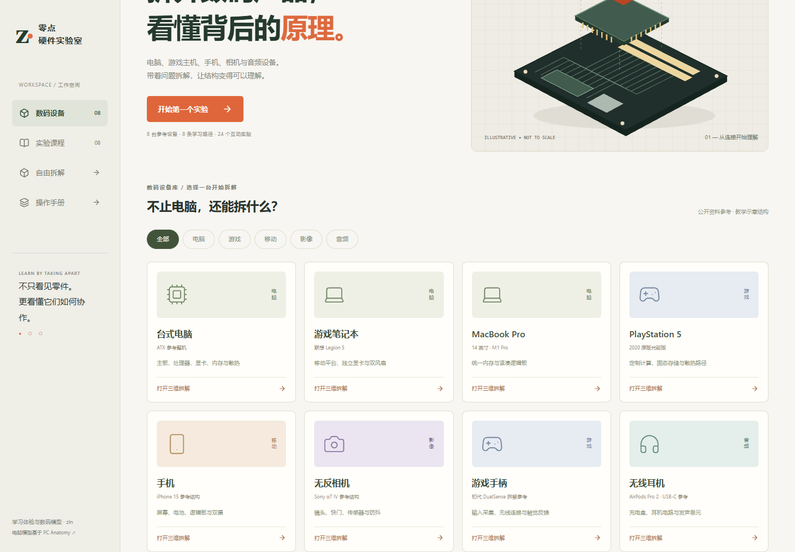
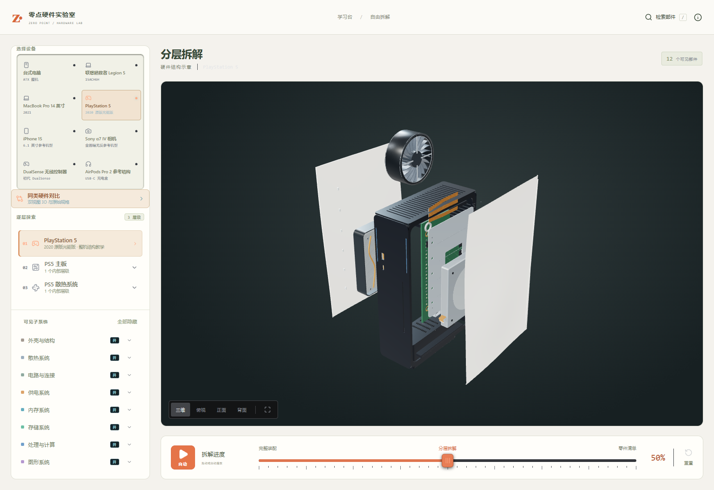
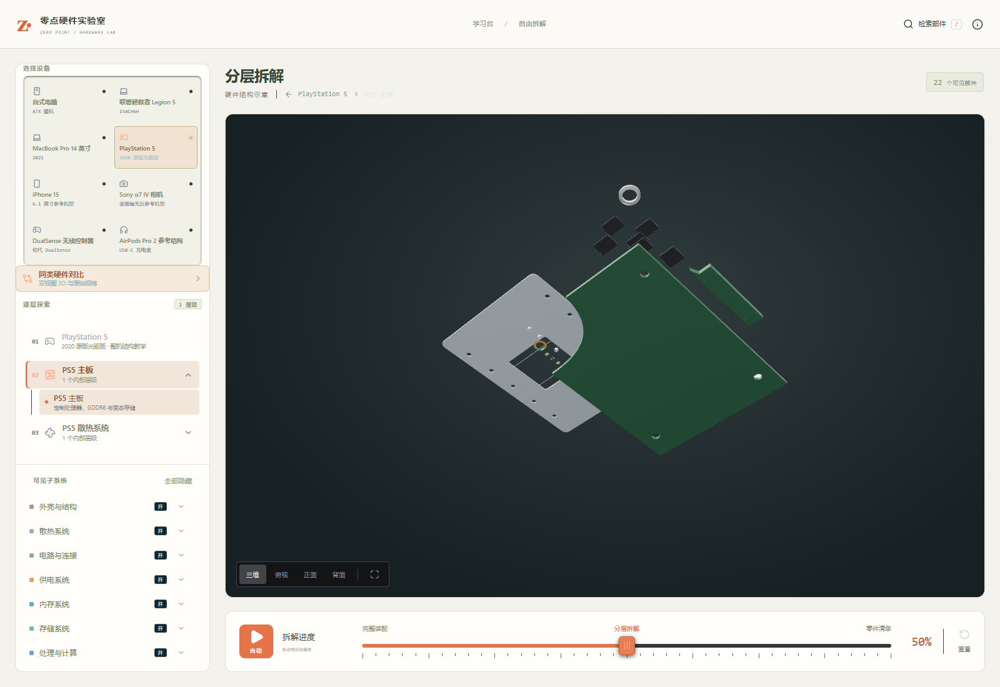
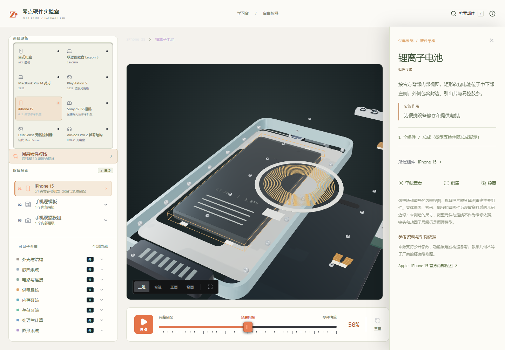
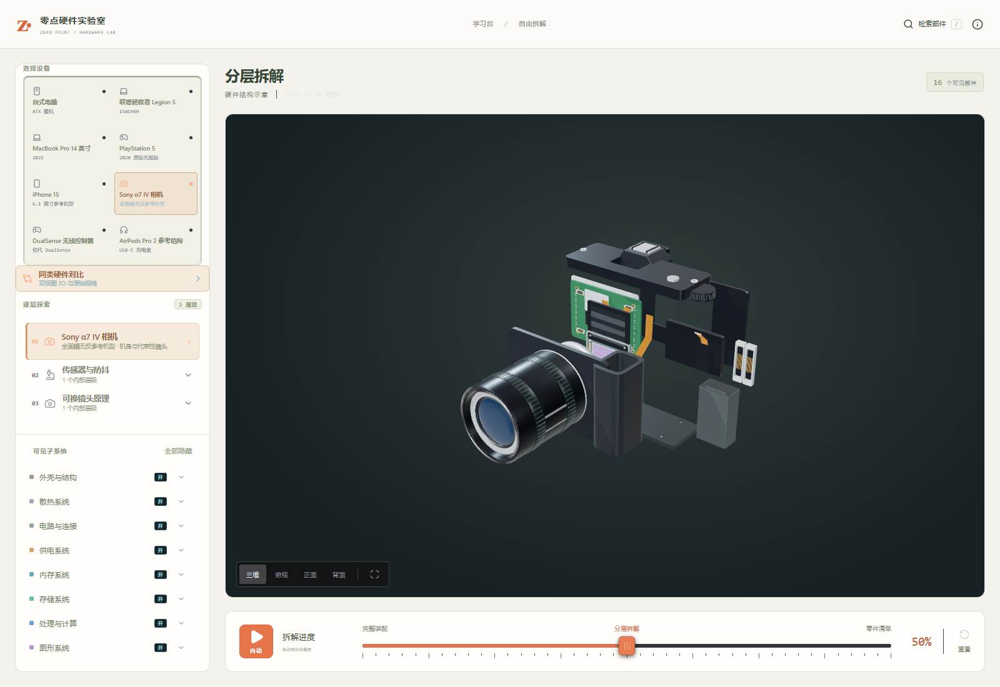
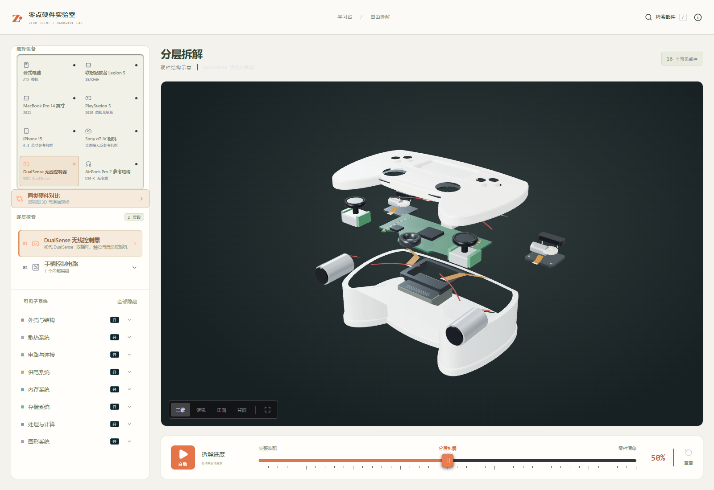

# 零点硬件实验室

**Zero Point Hardware Lab · 拆开，才能看懂。**

一个面向硬件爱好者的中文交互式 3D 学习应用。从电脑到 PS5、手机、相机、手柄与无线耳机，通过「观察 → 拆解 → 理解」认识设备内部的结构与协作。

[在线体验](https://zero-point-hardware-lab.vercel.app/) · [中文指南](https://zero-point-hardware-lab.vercel.app/guide/zh-CN.html) · [建模范围](docs/DIGITAL-DEVICES.md) · [验证记录](docs/VALIDATION.md)



## 可以探索什么

**8 台参考设备 · 82 个探索层级 · 741 条部件资料 · 8 条学习路径 · 24 个互动实验**

| 设备 | 探索内容 | 打开模型 |
| --- | --- | --- |
| 台式电脑 | 机箱、主板、CPU、GPU、内存、存储与芯片层级 | [台式机](https://zero-point-hardware-lab.vercel.app/?scale=pc) |
| Legion 游戏本 | 整机布局、主板、可更换内存与封装 | [Legion](https://zero-point-hardware-lab.vercel.app/?scale=legion) |
| MacBook | 紧凑主板、集成芯片与散热布局 | [MacBook](https://zero-point-hardware-lab.vercel.app/?scale=macbook) |
| PlayStation 5 | 原版光驱机参考结构、主板与散热系统 | [PS5](https://zero-point-hardware-lab.vercel.app/?scale=ps5) |
| iPhone 15 参考结构 | 屏幕、电池、逻辑板与双摄模组 | [手机](https://zero-point-hardware-lab.vercel.app/?scale=phone) |
| Sony α7 IV 参考结构 | 机身、传感器防抖与通用镜头原理 | [相机](https://zero-point-hardware-lab.vercel.app/?scale=camera) |
| 初代 DualSense | 输入机构、控制电路与反馈模块 | [手柄](https://zero-point-hardware-lab.vercel.app/?scale=gamepad) |
| AirPods Pro 2 USB-C 参考结构 | 双电芯、充电板、托盘、耳机内部与动圈原理 | [耳机](https://zero-point-hardware-lab.vercel.app/?scale=earbuds) |

这些是帮助理解结构与功能的教学模型，不是精确维修图、完整物料清单或真实性能模拟。具体型号参考与通用原理模型的范围见[设备参考](docs/DIGITAL-DEVICES.md)。

## 结构重建更新

新增五类设备已按实机拆解、Apple 内部视图及 Sony ILCE-7M4 分解资料重做主要结构：异形 PCB、双面封装、薄壁开孔壳体、柔性排线与连接器、独立执行器、托盘及代表性紧固件。PS5 主板细分 8 颗 GDDR6 与两面共 6 颗 NAND；手机纠正底部组件布局，补齐 TrueDepth 与接口连接；手柄拆分左右扳机的电机、蜗杆与齿轮。

几何由项目独立编写，不直接使用拆解照片当贴图。建模依据、已核对事实与未测绘部分见[重建记录](docs/DIGITAL-DEVICES.md)。

## 不只是看模型

- **自由拆解**：旋转、缩放、连续拆解与零件清单，支持选择、隐藏、隔离、聚焦、层级深入和对比。
- **中文导读**：默认展示中文功能说明；原有电脑资料保留可展开的英文原文和原始规格，便于核对。
- **带任务的学习**：每条路径包含 3 个实验。到达指定层级并满足拆解要求后解锁知识检查，答错可重试，答对记录完成。
- **随时继续**：当前浏览器保存进度，支持继续未完成实验、复习与重置。无需账号或翻译 API。
- **分享具体位置**：用 `?scale=phone&open=60` 分享模型与拆解进度；用 `?lesson=mobile` 进入手机课程。
- **响应式工作台**：中文设备分类、学习日志、独立滚动面板与手机任务抽屉。



<details>
<summary>更多预览：PS5 主板、手机、相机与手柄</summary>









</details>

## 本地运行

需要 **Node.js 22.13+**（已使用 Node.js 24 验证）、npm，以及支持 WebGL 的现代浏览器。

```bash
git clone https://github.com/zhenglinniao/Zero-Point-Hardware-Lab.git
cd Zero-Point-Hardware-Lab
npm ci
npm run dev
```

打开终端显示的地址，通常为 `http://localhost:5173/`。

```bash
npm run build   # TypeScript 检查并生成 dist/
npm start       # 预览生产构建，默认 http://127.0.0.1:4173/
```

纯静态前端，无服务端、数据库或运行所需的 API 密钥。学习记录保存在当前浏览器，不会跨设备同步。

## 技术与目录

React 19 · TypeScript · Three.js · Vite 8 · Tailwind CSS 4 · Node.js Test Runner · Playwright

```text
app/                   中文学习台、课程任务与拆解工作台
lib/digital/           新增数码设备目录与程序化 3D 几何
lib/learning.ts        学习路径、知识检查与进度校验
lib/zh.ts              离线中文术语与功能导读
lib/                   硬件目录、层级定义与渲染逻辑
public/guide/          静态使用指南
tests/                 逻辑、目录、模型边界与链接测试
scripts/               浏览器验收、体积检查与目录生成工具
docs/                  参考来源、开发记录、截图与验证记录
```

架构见 [ARCHITECTURE.md](ARCHITECTURE.md)，开发节点见 [docs/DEVELOPMENT.md](docs/DEVELOPMENT.md)。

## 验证

```bash
npm run check
npm test
npm run build
npm run size
```

已通过 **123 项测试**。另提供浏览器验收，覆盖学习流程、进度持久化、新设备拆解、部件交互与移动布局。先运行生产预览，再在另一个终端执行：

```bash
node scripts/learning-smoke.mjs
node --experimental-strip-types scripts/digital-smoke.mjs
```

脚本默认使用 Windows Edge、连接 `http://127.0.0.1:4173/`。其他环境用 `BROWSER_EXECUTABLE` 指定浏览器路径、`NOTEBOOK_BASE_URL` 指定站点。完整覆盖范围和局限见[验证记录](docs/VALIDATION.md)。

## 部署

生产站点部署于 [Vercel](https://zero-point-hardware-lab.vercel.app/)，已连接本 GitHub 仓库，推送触发自动部署。仓库包含 `vercel.json`，构建命令为 `npm run build`，输出目录为 `dist`。也可将 `dist/` 部署到其他静态托管服务的网站根路径。

使用 Vercel CLI 更新部署：

```bash
npx vercel login
npx vercel link
npx vercel --prod
```

更换域名时，请统一修改首页、指南、`public/robots.txt` 和 `scripts/sitemap-urls.ts` 中的站点地址，然后运行 `node --experimental-strip-types scripts/generate-sitemap.mjs`。子路径部署还需调整 Vite `base` 与静态链接。

## 来源、原创扩展与许可

本项目基于 Yoseph 的 MIT 开源项目 [PC Anatomy](https://github.com/Yoosseph/pc-anatomy)，复用其电脑模型、渲染器及相关资料；上游快照为 `ace99de7956f741b6bdb70de56d5dc4b4aafb7ae`。

zln 在此基础上设计实现中文学习台、原创 SVG 结构示意、课程与知识检查、学习记录，以及 PS5、手机、相机、手柄和耳机的程序化教学几何、部件目录与课程。中文功能导读属于解释性整理，原有英文资料与数值规格保留以供核对。

硬件参考与厂商资料见 [SOURCES.md](SOURCES.md) 和[数码设备参考](docs/DIGITAL-DEVICES.md)。产品名称与商标归其各自权利人所有，本项目不代表厂商官方产品。

代码采用 [MIT License](LICENSE)，保留原作者版权声明。[原始 README](docs/UPSTREAM_README.md) 一并保留。
