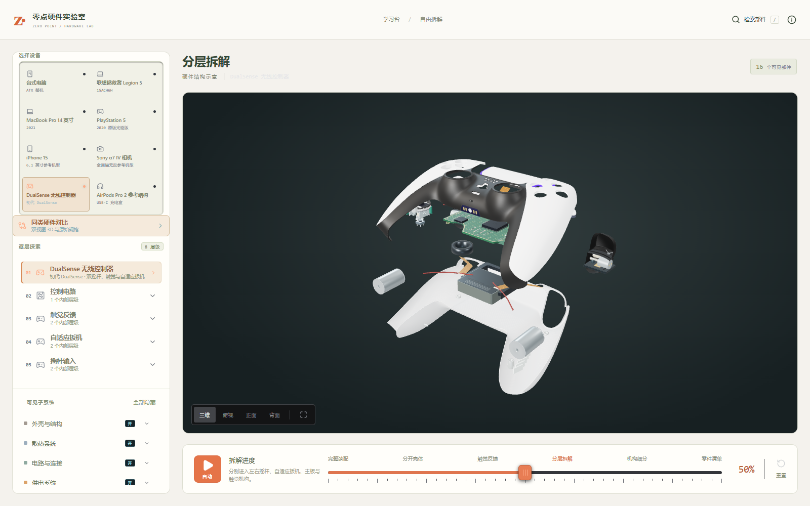
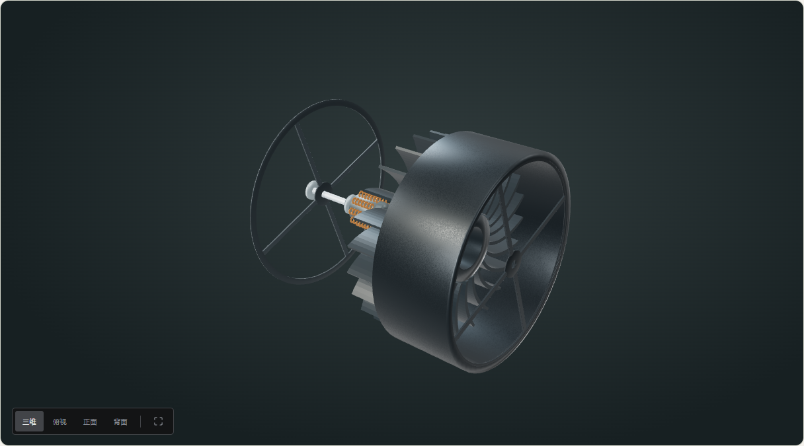
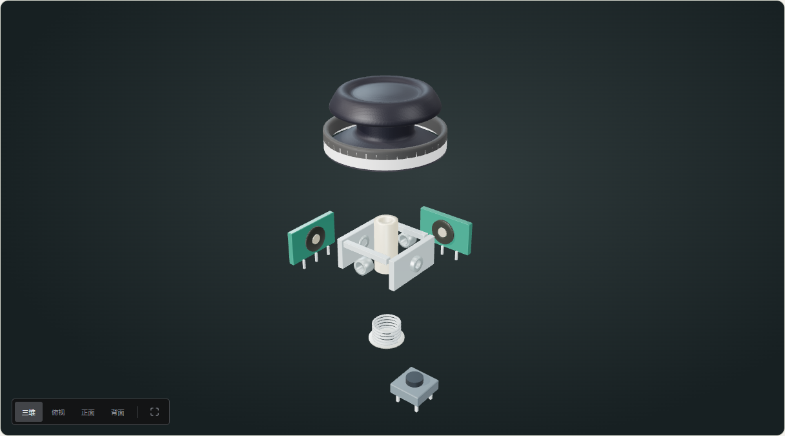

# 五类设备的几何自查与修复

2026-10-19。本轮不增加设备、层级或部件数量，优先修复已存在的形状与装配错误。

| 发现的问题 | 本轮修复与证据 |
| --- | --- |
| 相机电池为估画尺寸，握柄未按电池校核 | 按 Sony NP-FZ100 官方 38.7×22.7×51.7 mm 外形，转为握柄内的安装方向；改为连续前壳与握柄曲面，重建相通空腔。电池和卡槽的网格间隙通过实际三角网格射线采样检查。 |
| 相机侧壁未延伸到后壳，卡槽外露 | 延长前壳侧壁至后壳接缝，调整卡槽位置，检查其位于握柄空腔内。 |
| 整机镜头暴露教学剖切面 | 整机安装时显示完整筒壁并隐藏剖切端面；进入独立镜头层级后才显示内部剖视。光学处方及像平面关系保持。 |
| 手机磁环与逻辑板屏蔽高度重叠 | 分开线圈和磁环高度，磁环位于屏蔽罩之上、背玻璃之下；使用实际模型包围盒核对间隙。 |
| 耳机盒上下壳的空腔方向反了 | 下壳向上开口、上盖向下开口，恢复正确底壁和顶壁；用实际壳体网格从开放方向发射射线检查。 |
| PS5 卡扣浮在曲面内侧 | 卡扣与侧盖网格共用同一个曲面函数，沿内壁布置；检查十二个安装点到实际内壁的距离。 |
| 手柄扳机内部底板和连线超出后缘 | 缩小内部底板包络、调整电机长度与线路弯曲；触发总成的后缘回到外观模型范围。塑料粗糙度增加，减少不合理金属反光。 |

Sony 原始尺寸来源：[NP-FZ100 官方规格](https://www.sony.co.uk/electronics/interchangeable-lens-cameras-batteries-chargers/np-fz100)。相机外壳曲率仍为资料参考重建，不把这次修复描述成原厂 CAD。

全项目单元测试 140 项通过，数码定向测试 28 项通过；构建、类型、lint 和入口预算通过。已重看五台设备装配、50% 拆解以及独立镜头剖视，未捕获页面异常；相机侧壁收口后单独重看。没有重复执行上轮所有课程流程，也没有将这些检查表述为全体零件连续运动的无碰撞证明。

## AirPods 外形与装配重建

用户截图暴露的盒口破面、厚板式盒盖和无法辨认耳机的问题，说明上一轮仅修正空腔方向仍不足以解决外观质量。本轮集中重建 AirPods，不以测试通过代替视觉验收。

- 上下壳共用 60.6 × 45.2 × 21.7 mm 完整轮廓，按同一曲面分段。用解析截面生成薄壁、连续盒口和约 0.2 mm 接缝，替换无法稳定采样薄边的体素盒壳。
- 上盖在 0%–16% 围绕固定后侧轴翻开约 105°；耳机随后垂直退出，托盘延后提起。新增“开盖查看”停靠点，保留完整装配、分层拆解、零件清单。
- 托盘不再用越过外轮廓的矩形孔拼接，改为左右镜像的声腔凹位、向内耳塞凹位和偏置耳柄杯。开孔和凹杯共用轮廓数据。
- 耳机壳体重新处理耳柄、声腔和出声颈部的连续曲面；互补壳片用精确平面切分和封边，消除体素截口锯齿。耳塞翻转到正确出声方向，泄压网按曲面贴附。
- 发声单元转向出声口，电池、耳柄电路、麦克风、排线和接点重新安排；消除原来伸出外壳的连接板和接点。调整充电盒内电芯、板卡和线圈间距。

外形尺寸依据 [Apple 官方规格](https://support.apple.com/en-nz/111834)，结构对照 [Lumafield 第二代 AirPods Pro CT 拆解](https://www.lumafield.com/first-article/posts/virtual-teardown-apple-airpods-pro-2nd-generation)。内部安装尺寸、壳体曲率、开盖角度与凹槽仍为参考重建参数，并非从 CT 中提取的原厂网格。

验证增加耳机元件相对 1 mm 壳壁的采样净空、盒内组件与圆角空腔的采样净空、实际耳机三角面在托盘厚度内三个截面的通孔检查、铰链固定点和可逆性、先取耳机再提托盘的顺序检查。全项目 145 项、数码定向 33 项通过，类型检查、生产构建、lint 与入口预算通过。浏览器重看闭合、16% 开盖、50% 拆解、100% 清单，以及单耳机装配与拆解。

这些检查覆盖上述几何约束和观察姿态，不表示所有微型零件、任意连续运动与全部视角均已通过完整网格碰撞检测。

## Sony α7 IV 外观与背部闭合重建

原模型用平板顶盖与通用后壳近似机身，取景器、按键、侧翻屏与 α7 IV 的辨识特征差距明显；背壳开孔和显示屏错位，导致主板从闭合机身后方露出。本轮按 Sony 的 ILCE-7M4 部件图重新组织外观，并保留既有内部总成与分享 ID。

- 以收窄的梯形取景器上盖、独立眼罩、热靴导轨和接点替换通用凸块；改为带握柄前伸区与取景器避让区的肩部盖。
- 重建双层静态/视频/S&Q 与 P/A/S/M 拨盘、双后拨轮、前拨轮、快门电源环、录像键、C2 和两侧背带环。
- 重排 C3、MENU、AF-ON、AEL、摇杆、Fn、控制轮、回放与 C4；显示屏框、有效显示面和侧铰链完整覆盖后壳窗口。
- 修正光轴朝前时握柄的左右镜像错误；外壳、部件安装位置和拆出方向同步转换，文字单独保持正常阅读方向。
- 调整 SONY/α/7 IV 标识的实际字面大小和贴面方向，使用低金属度机身、较粗糙的握柄与独立橡胶眼罩；整机光学玻璃改用透射与深度处理，避免多层半透明玻璃累加成白色圆盘。

参考：[Sony 正面部件图](https://helpguide.sony.net/ilc/2110/v1/en/contents/TP1000660241.html)、[顶部部件图](https://helpguide.sony.net/ilc/2110/v1/en/contents/TP1000660253.html)、[官方完整帮助指南中的 Rear side](https://helpguide.sony.net/ilc/2110/v1/en/print.html)、[官方尺寸规格](https://www.sony.com/electronics/support/e-mount-body-ilce-7-series/ilce-7m4/specifications)。轮廓曲率、按键尺寸、纹理与安装间隙仍为参考重建，并非原厂测绘数据；所装镜头不是指定 Sony FE 镜头的复刻。

新增后壳/屏幕射线遮挡检查：屏幕窗内九个观察点首先命中显示总成，外侧代表点命中背壳。新增握柄方向和正反面标识阅读方向检查。全项目 148 项测试、类型检查、生产构建、lint 与入口预算通过。浏览器检查整机三维、正面、背面、顶部，以及 50% 拆解与 100% 清单。没有将这些检查称为完整连续网格碰撞证明。

补充检查：共享同类材质以合批拨盘滚花，并在合批烘焙镜像坐标时保持三角面朝向；新回归检查覆盖合并后的顶盖与背壳面朝向。最终数码定向 36 项通过。
## 全设备观察步骤与机械总成深化

本轮按八台整机逐一查看装配与 50% 分层画面，保留台式机和两类笔记本已有深层结构；新增九个实际机构层级、51 条中文部件说明。项目现为 100 层级、859 条资料。没有把原有 91 层几何全部重新制作。

| 设备 | 检查 / 修改 | 层级数（含整机） |
| --- | --- | ---: |
| 台式电脑 | 复查整机与分层；保留原模块建模，补六个观察节点 | 38 |
| Legion / MacBook | 复查整机与分层，屏幕标识改为 ZERO POINT LAB，分别补六步观察 | 各 15 |
| PS5 | 新风扇总成复用到整机；护框与转子分离，转子内安装铜绕组、定子、轴和轴承；调整前缘格栅的宽度与明度 | 6 |
| iPhone 15 | 触觉机构拆盖板、薄壁壳、悬置质量、绕组、弹片和连接；底部扬声器拆声腔、振膜、音圈、磁路与接点 | 6 |
| Sony α7 IV | 保留上一轮外形与闭合关系；取景器分外壳、眼罩、光学窗口、屈光轮、热靴；翻转屏分框架、显示层与侧铰链 | 7 |
| DualSense | 左右扳机各七个可选机构，左右摇杆各六个；右侧内部安装镜像；保留全部 81 个授权外观网格且不重复安装 | 8 |
| AirPods Pro 2 | 保留曲面、空腔和入盒姿态，复查铰链与先取耳机后提托盘的顺序；单耳、发声单元与耳柄电路按功能归入同一分支 | 5 |

八台设备的六步入口是当前三维时间轴的观察节点，每个总成仍有独立拆解时间轴；并非真实维修操作顺序。整机安装同一份子层几何，原有部件分享 ID 保留。

审查中发现并修正：矩形绕线的样条在闭合段越出壳壁、摇杆授权帽体与新万向架之间悬空、按压开关靠近回复弹簧、右侧机构需要镜像，以及翻转屏子层默认看向背面。对应补充包络、间隙、连接与镜像回归检查。

验证：

- 全量 154 项测试通过；风扇叶尖小于风道内径、叶轮轴向避开护架；触觉内部组件在薄壁容腔内；扬声器音圈位于振膜下方；摇杆轴连接帽体且开关不穿过回复弹簧；右扳机安装坐标镜像。
- `npm run audit:models` 对全部 100 层、2878 个可选零件实例检查非空有限网格、目录归属、0/50/100% 共 300 个姿态与装配复位。此项为无 GPU 几何检查，不验证贴图像素或所有三角面的碰撞。
- 浏览器覆盖全部 32 个数码层级的装配/分层/清单、五条课程、中文资料、隐藏恢复、深入返回与移动端，无 pageerror。八台整机另保存装配、分层和清单截图。
- 类型检查、生产构建、lint 和入口体积预算通过。

参考：[Sony PS5 官方拆解](https://blog.playstation.com/2020/10/07/ps5-teardown-an-inside-look-at-our-most-transformative-console-yet/)、[iFixit 扳机机构拆解](https://www.ifixit.com/Teardown/PS5+Controller+Trigger+Teardown/158397)、[iFixit 双轴电位器与回中机构](https://www.ifixit.com/News/48944/heres-why-ps5-joysticks-drift-and-why-theyll-only-get-worse)、[Apple iPhone 15 维修目录](https://support.apple.com/en-ca/104900)。轴承、风扇定子、微型触觉及声学内部的机械尺寸仍是功能与照片支持的参考重建，不是原厂 CAD 或测绘数据。未宣称全部微型零件与任意连续运动均通过完整网格碰撞检测。

补充：八台设备的 48 个步骤按钮逐一达到目标姿态；九个新总成的深入和返回、三种设备的手机端布局通过。全模型几何审查已加入 CI，后续提交会继续执行。
