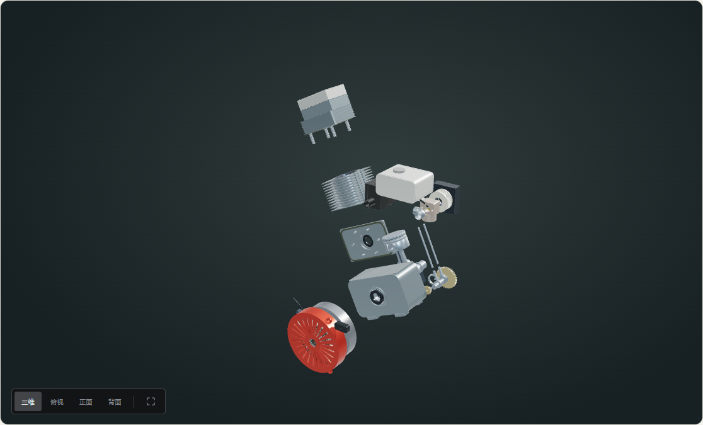
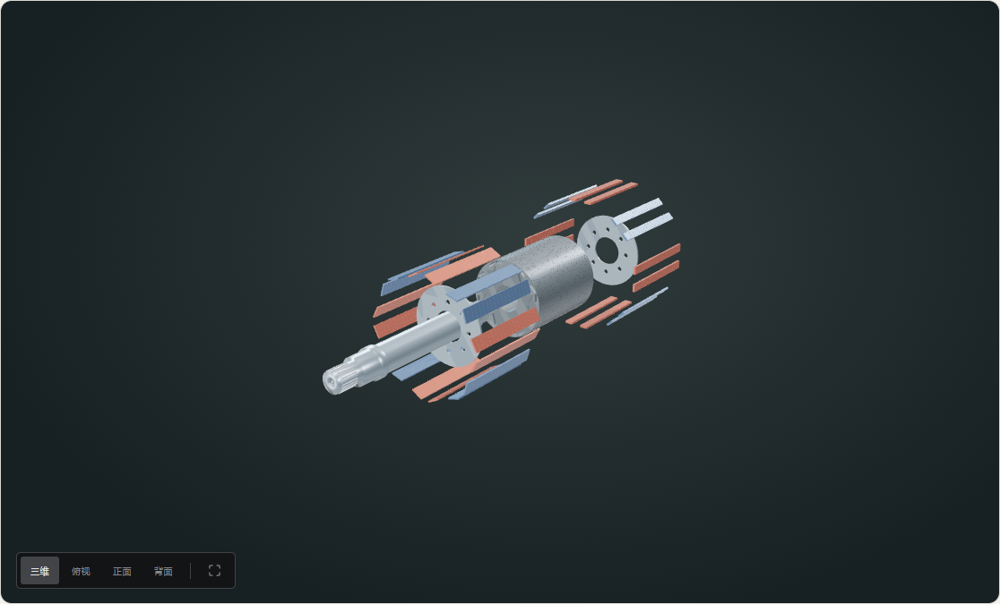

# 内燃机与电动车电机：参考、建模和验证

2026-10-19 后续已修正缸盖／气门相交、定子子层路径、机体剖视、油环开口与多项装配基准。最新实现和未关闭事项见[动力模型整改记录](POWERTRAIN-REBUILD.md)；下文为首次实现时的历史记录，原有数量、演示顺序和局部几何描述可能已经变化，不构成整机精度验收。

两套模型是依据公开资料约束的程序化参考重建。没有使用来源不明的成品 CAD，也不将教学建模参数标为厂家测绘值。2026-10-19 复核。

## 入口与层级

- [Honda GX160 UT2 内燃机](https://zero-point-hardware-lab.vercel.app/?scale=engine)：10 个层级，95 个可选零件／总成。缸体与曲轴箱、气缸与缸套、侧盖与密封、曲柄连杆、活塞环销、OHV 配气、正时调速、供油进排气、飞轮与手拉启动。
- [2012 LEAF 驱动电机](https://zero-point-hardware-lab.vercel.app/?scale=evmotor)：6 个层级，252 个可选零件／总成。机壳水冷、定子绕组、双层 IPM 转子、轴承内部和三相接线盒。端盖、紧固件和两侧支承在整机分别选择。

347 是跨层级的可选条目数，包含总成入口，不能当作独立物理件的 BOM 数量。叠片、铜线股、磁钢轴向分片等重复几何在所属零件内分组。全站现有 10 台参考设备、116 个层级、1,208 条资料。

## 直接可核实的尺寸

| 参考 | 公开值 | 几何采用值与用途 |
| --- | --- | --- |
| Honda UT2 规格页 1-11 | GX160 缸径 68 mm、行程 45 mm；单缸、四冲程、25° 倾斜 OHV | 68 mm 缸孔，22.5 mm 曲柄偏心；机体内部共用 25° 安装朝向 |
| Honda UT2 服务页 2-3 | 活塞裙径 67.985–67.995 mm | 67.990 mm 裙径；检查缸套与实际活塞网格 |
| 同上 | 活塞销 17.994–18.000 mm | 空心销外径 17.997 mm |
| 同上 | 曲柄销 29.970–29.980 mm；连杆大头孔 30.020–30.033 mm | 29.975 / 30.026 mm；曲柄销与开口大头保持间隙 |
| 同上 | 导管孔 5.500–5.512 mm，进／排气阀杆各有独立服务范围 | 导管孔 5.506 mm；阀杆分别 5.474 / 5.433 mm |
| Honda 装配图 | GX160 进气门盘 25 mm、排气门盘 24 mm，25×41×6 mm 油封 | 两只气门保持不同盘径；轴封独立建出 |
| ORNL 2012 拆测报告，第 22 页 | 48 槽、8 极；定子外径 198.12 mm；转子外径 129.97 mm、叠长 151.16 mm | 三个包络与槽／极数量保持一致 |
| ORNL 2013 Electric Motor R&D，第 14 页 | 定子内径 130.96 mm、叠长 151.38 mm；轴径 44.45 mm | 同轴装配；径向气隙由直径相减得到 0.495 mm |

原始资料：[Honda UT2 官方手册](https://www.honda-engines-eu.com/files/files/shop-manual-gx120-160-200-ut2-en.pdf)、[Honda 装配图](https://www.honda-engines-eu.com/files/files/engine-assembly-gx120-200-en.pdf)、[ORNL 2012 实测照片](https://www1.eere.energy.gov/vehiclesandfuels/pdfs/merit_review_2012/adv_power_electronics/ape006_burress_2012_p.pdf)、[ORNL 2013 尺寸与绕组资料](https://www.energy.gov/sites/prod/files/2014/03/f13/ape051_miller_2013_o.pdf)。照片和 PDF 仅用于核对，不随网站打包。

## 重建范围与一致性

**内燃机。** 中空曲轴箱、独立侧盖、缸套、环槽、销孔、分体连杆大头、气门导管、推杆通道、弹簧、摇臂和启动器分别建模。曲轴在两片曲柄之间留出空间，通过偏置曲柄销连接，避免把连续主轴穿过连杆。四冲程正时采用 20:40、模数 1.5 的重建齿轮，轴距 45 mm；这组齿数不是本田实测。连杆中心距 70 mm、活塞冠／裙高度、铸件轮廓、气道、孔位、管线、油箱与消声器均为参考重建。气门弹簧的手册自由长度与当前压缩安装长度不是同一参数。

**电机。** 定子建立真实空心内孔与 48 个槽口，每槽分别提供绝缘衬、槽楔与铜导体束。铜线使用实例化几何：每槽 120 股约 0.8 mm 可见导体表达六匝和并绕线束；不是逐股 OEM 布线测绘。24 个跨距 5 槽的短距线圈分别连接两组槽边，端部曲线按分层教学布局重建。

转子使用外层平直、内层 V 形的双层拓扑，32 条磁钢组分别嵌入实际槽孔，每组显示 18 个轴向分段。拓扑及部分截面参数参考 [Motor-CAD 原教程的第三方托管版本](https://www.selidori.com/tech/00000-04999/1436-c03IY.pdf)，该教程本身也是模型。教程中的 132 mm 定子孔、1 mm 气隙和 160 mm 叠长没有覆盖 ORNL 的实测尺寸。磁钢位置为满足当前包络和极间隔重新布置，不能据此声称原厂磁片形状、分段总数、磁化方向或电磁性能已经精确还原。

轴承规格、滚珠数、感知器齿形、水套流道、端盖、接线盒、支承件和紧固布局为重建。电机不包含逆变器、减速器或整车电池。未进行 CFD、FEA、燃烧、热、应力或真实工况效率仿真。

**装配。** 整机直接安装子层级的同一份毫米几何，只有统一缩放与安装旋转。拆解是观察动画：先移开端盖、侧盖或气缸，随后沿轴向退出运动机构，再分散到侧边。70% 后转入零件清单布局，不把清单排版当作维修拆卸路径。

## 验证范围

`tests/powertrain.test.ts` 检查以下实际网格及关系：

- 槽、极、相数量；排量、行程、径向气隙和四冲程 2:1 关系。
- 转子／定子铁芯包络与叠长；活塞销／销孔、气门杆／导管、滚珠／滚道／保持架。
- 包含实例化铜线的槽内配合；32 条磁钢组与对应铁芯槽孔。
- 电机转子／定子、夹套／定子在 0–70% 每 2% 的网格交叉检查，逐步验证轴向退出。
- 曲轴／连杆／大头盖、曲轴箱／曲轴／正时轮、缸套／活塞、推杆／缸体与鳍片。

这些是针对明确对象的表面交叉和尺寸检查，不是全 BOM 全姿态碰撞求解，也不验证零件生产公差、真实应力或维修操作可达性。配合面、密封接触和教学排布需结合说明理解。

浏览器检查覆盖新增 16 个层级各自的 0%、50%、100% 状态，共 48 个状态；另查 390 px 手机视图、首页 10 台设备和“动力”分类入口。全项目类型、lint、测试、构建、包大小和 116 层级几何审计随仓库 CI 执行。

## 实际渲染

实现分为 `lib/powertrain/dimensions.ts`（共享尺寸与绕组／磁钢布局）、`catalogue.ts`（中文零件资料与路径）、`geometry.ts`（毫米几何）。新增类别为机械与传动、电磁系统、进排气与流体。
