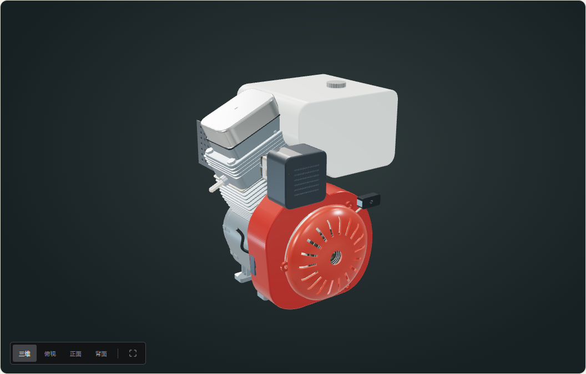
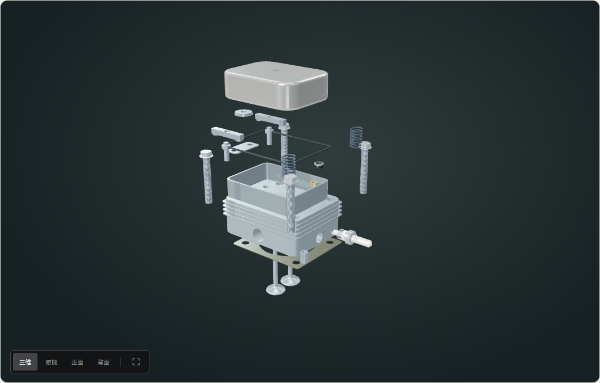
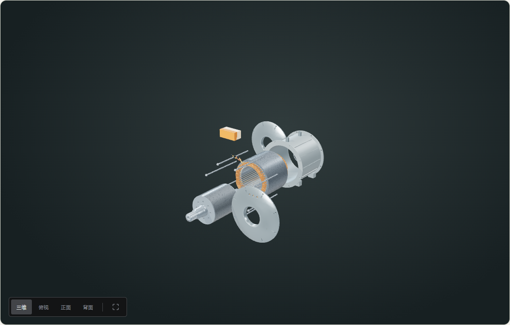
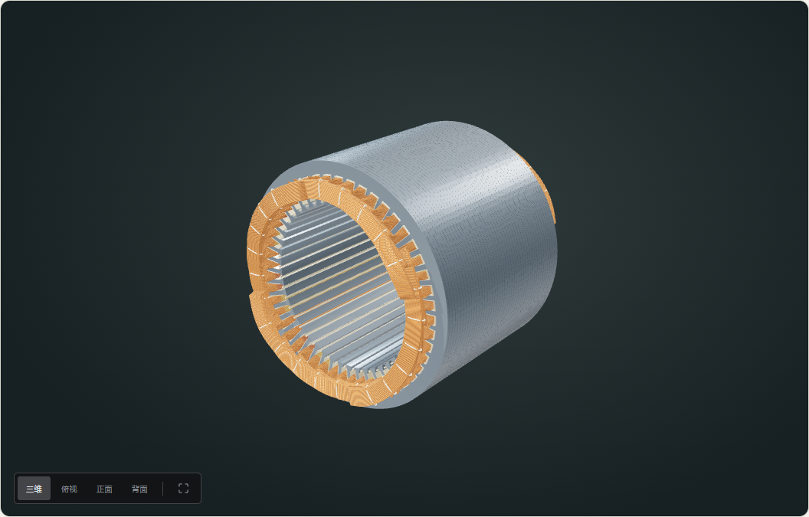

# 动力模型结构重建与审查整改

2026-10-19。接续 [40 项审查](MODEL-REVIEW-2026-10-19.md)。本轮集中重建用户指出的 GX160 和 LEAF 电机，另修正 AirPods 版本链接、台式机平台／电源说明及全站精度说明继承。**不是宣布原清单的 40 项已经全部关闭。**

## 改变了什么

此前主要用规则壳体和相互独立的平移构成整机。本轮将铸件、孔道、接触点、密封面和紧固基准一起建立，先保证装配关系，再增加可识别的外形。

| 系统 | 具体修改 |
| --- | --- |
| GX160 主体 | 异形曲轴箱、后轴承孔、凸轮腔、气缸开口、带孔的安装法兰；侧盖与密封垫使用共同轮廓；六个螺栓位置由同一数据驱动，不再悬在曲轴室中间 |
| 气缸与机体 | 气缸区域与曲轴箱视作同一铸件；缸套不再被动画当作普通可卸套筒抽走。保留局部观察入口，隐藏／清单与真实拆卸明确区分 |
| 缸盖 | 布尔切出燃烧室、独立气门喉口、导管孔、进排气横向通道、火花塞孔、推杆孔和定位孔；增加进气杆油封、定位套、推杆导向板；修正摇臂支点和接触垫 |
| 尺寸链 | 冠顶、缸口、缸垫共用基准，将旧的约 11.5 mm 顶隙改为本次重建的 0.7 mm；推杆长度由挺柱端和摇臂接触点计算，不再沿用不闭合的独立常量 |
| 活塞环 | 上下油环刮片分别设置角度，环口弧长间隔约 13.6 mm；压缩环组继续错开。该间隔依据 Honda 装配要求检查 |
| 外围附件 | 重建带下肩避让的薄壁油箱、加油口、油箱托架；化油器、隔热座、进气垫、长螺柱、空滤底座与缸盖气孔对齐；补启动棘爪，重做导流罩、曲面通风启动盖及圆角摇臂盖 |
| LEAF 壳体 | 有支承脚与法兰的水套、碟形端盖、同轴轴承座、端盖孔与贯穿螺栓对齐；修正旧长螺栓悬空伸出的位置 |
| 冷却通道 | 入口和出口实际贯通外壁；上方加强筋避让水口；接管不伸入内筒壁；分隔水道保留交替连通窗口，内筒仍隔离定子空间 |
| 绕组 | 槽边与端部共用每根导体的坐标；每槽六匝、20 股并绕的可见束，端部按逐匝连接组织；加入绑扎、开口引线及端盖绝缘引出段。三相／支路仍为教学等效，不是 OEM 网表 |
| 拆解路径 | 定子铜束／绝缘件先沿轴向退出，端部绕组与铁芯保持剖分观察关系；避免径向穿过槽壁；整机转子继续先轴向退出再侧移 |
| 资源与加载 | 实体布尔运算在离线生成阶段执行，浏览器只读取网格；生成网格压缩、单独分块，只有打开动力设备时加载，电脑／手机入口不预载这些铸件 |

目前动力部分仍为 16 层，共 **363 个可选零件／总成条目**：发动机 108，电机 255。条目包含重复总成入口，不是独立实物 BOM 数量；重复导体、磁片等几何也不能简单计作独立可维修零件。全站层数仍为 116。

## 拆解演示的实际含义

GX160 整机阶段为：完整装配 → 外件拆卸 → 隐藏铸件剖视 → 零件清单。35% 至清单前隐藏机体的铸件区域，曲轴、连杆、活塞和推杆仍保持装配位置。**没有让曲柄带着活塞横向穿出一体气缸。** 各子层可继续查看内部件。

`engine-cylinder` 是一体铸件的局部观察，不模拟无损拔出铸入缸套；`ev-stator` 是制造／剖分演示，真实浸漆绕组也不可能按观察动画逐根无损移开。70% 之后仍是资料清单排版。

## 使用的依据与未公开范围

- [Honda UT2 官方手册](https://www.honda-engines-eu.com/files/files/shop-manual-gx120-160-200-ut2-en.pdf)：缸径、行程、服务尺寸及型号范围。当前官网 PDF 只有部分章节，不能据此声称所有内部件已核实。
- [Honda 官方装配图](https://www.honda-engines-eu.com/files/files/engine-assembly-gx120-200-en.pdf)：环口、定位、机体／侧盖、配气和调速关系。图中同时存在不同系列／年代，不能全部机械照搬进 UT2。
- [Honda 经销商的 UT2 配气零件目录](https://hondaeast.powerdealer.honda.com/parts/engines/engines/gx/GX160/GX160UT2-HX2_A/Z4M0E0900A/references)：用于交叉核对共用配气件、杆密封和推杆导向板。HX2/A 整机 PTO 结构不作为本模型的无减速器布局证据。
- [ORNL 2013 第 14 页](https://www.energy.gov/sites/prod/files/2014/03/f13/ape051_miller_2013_o.pdf)：定子／转子包络、叠长、48 槽／8 极／3 相与并绕线规。
- [ORNL 2012 第 21–23 页](https://www1.eere.energy.gov/vehiclesandfuels/pdfs/merit_review_2012/adv_power_electronics/ape006_burress_2012_p.pdf)：绕组端部、绑扎、端子、壳体和轴系的实物照片。

新增曲面、壁厚、安装脚、法兰孔位、气道截面与水道仍是上述公开图片约束的重建，**不是厂家测绘 CAD**。网格按 0.01 mm 量化只是存储精度，不是对真实产品的误差声明。离线网格简化保持边界，设置不超过 0.002 mm 的算法误差；这同样不证明重建尺寸来自厂家。

### 对上一轮审查的修正

R05 提到的排气旋转件来自混合机型装配图。重新核对 UT2 零件目录后，本轮没有把它继续作为所有 UT2 都必备的独立旋转帽；采用目录支持的导向板和杆密封，保留版本差异说明。此前“照图增加旋转件”不能当作型号还原的充分依据。

R04 的高度链已修正，燃烧室与阀口已有实际空腔；**仍未完成封闭气门状态的净余隙容积积分，不能宣布几何压缩比已经准确达到厂家 9.0:1**。该项保持部分完成。

## 审查项目状态

| 原编号 | 本轮状态 | 限制／后续 |
| --- | --- | --- |
| R01 | 已修复并加回归 | 两只气门与实际缸盖网格按 0–70%、每 2% 检查；不代替生产公差验收 |
| R02 | 已修复并加回归 | 多个槽位的导体、绝缘及端部与铁芯检查；未穷举任意零件对的连续路径 |
| R03 | 已修正演示关系 | 一体机体共同保持装配，局部入口为观察／剖分；铸件曲面仍需更多实物对照 |
| R04 | 部分完成 | 顶隙与推杆／摇臂尺寸链修正；净燃烧室容积与完整运动循环待验 |
| R05 | 已修环口与小件，并更正版本判断 | 油环间隔、定位套、导向板和密封；厂家细微形状仍待测绘 |
| R06 | 部分完成 | 槽边与端部逐匝连接，加入引线／绑扎；整套相带、并联支路和星点的 OEM 网表待证 |
| R07 | 已修复孔道与内壁隔离并加回归 | 射线验证水口贯通且内筒保持；当前水道为参考重建，未做流动仿真 |
| R08 | 已修正 | Apple 规格改为 2023 USB-C 页面 `111834`；其他耳机几何任务仍在 R28、R29 |
| R11 | 已补说明 | 台式机与 Intel 对比入口明确平台差异；电源模型为结构对比，加入 ASUS 1000W 推荐的配置边界 |
| R30 | 部分完成 | 缸盖、侧盖、外围装配链和启动罩已有重建；调速连杆、化油器内部等仍需继续细化 |
| R33 | 已扩大测试并明确边界 | 新增审查回归、水口与尺寸链检查，不将页面运行成功等同几何准确 |
| R34 | 已修复 | 动力子零件继承对应的准确性说明，数码设备不会再因存在说明被标成动力系统 |
| R37、R38 | 部分完成 | 减少分散距离；动力网格单独加载、离线简化；低配硬件长期帧时仍待测量 |
| R39 | 已清理与约束 | 清理旧磁钢／槽常量；油环、法兰和导体坐标使用共享参数；其余未测绘值继续标重建 |
| R40 | 动力部分已落实 | 真实外件拆卸与内部剖分区分；其余设备的制造／破坏性拆解仍需逐项完善 |
| R09、R10、R12–R29、R31、R32、R35、R36 | 尚未全面关闭 | 不能把动力模型本轮修正当作其余设备的型号级重建完成。仍按原报告的证据和验收条件执行 |

## 生成、复现和验证

```powershell
node --experimental-strip-types scripts/generate-powertrain-solids.mjs
npm run check
npm run lint
npm test
npm run build
npm run size
npm run audit:models
```

新增的几何回归见 `tests/powertrain.test.ts`：实际网格相交采样、油环开口、冠顶／缸口、侧盖孔位、剖视阶段和水口射线。`docs/model-review-2026-10-19/findings.json` 保留旧基线的问题，不覆盖历史证据；旧探测脚本运行时使用当前代码，因此结果会随修复改变。

新增工具 `three-bvh-csg` 与 `meshoptimizer` 只用于离线生成；浏览器通过原生 `DecompressionStream` 解压已生成的网格。Vite／格式工具及关联依赖一并更新，处理安装时审计发现的问题；不能因此推断应用没有其他安全问题。

最终结果：全量 172 项、动力专项 15 项、对比专项 6 项通过；类型、lint、构建和入口预算通过。116 层几何审计覆盖 348 个姿态；动力 48 个结构浏览状态及最终 14 个桌面／手机状态没有页面异常。机器可读记录见 [验收数据](powertrain-rebuild-validation.json)。

手机验收额外发现取景目标超过旧的 100 单位轨道限制，导致电机展开后相机无法收敛。本轮已修复探索与对比视图的范围限制，并按模型包络设置远裁剪；通过窄屏角点投影及实际手机视图验证。

Vercel CLI 初次上传因带入本地诊断产物而中止；新增 `.vercelignore`，仅上传应用构建输入，重试上传约 1.4 MB 后构建成功并绑定正式域名。文档、PDF、诊断截图、测试与本地环境文件不进入部署输入。

## 实际渲染

整机外观与配气部件：





电机总成与绕组端部：





[发动机内部剖视截图](screenshots/powertrain-rebuild-engine-section.png) · [390 px 手机拆解截图](screenshots/powertrain-rebuild-mobile.png)
