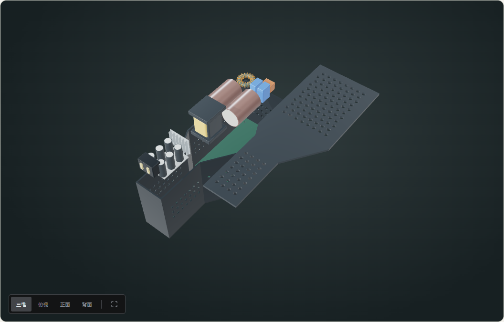
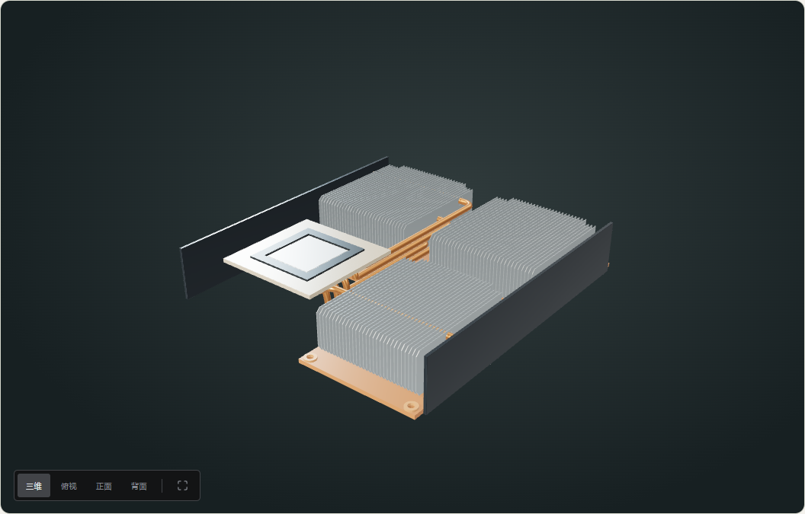
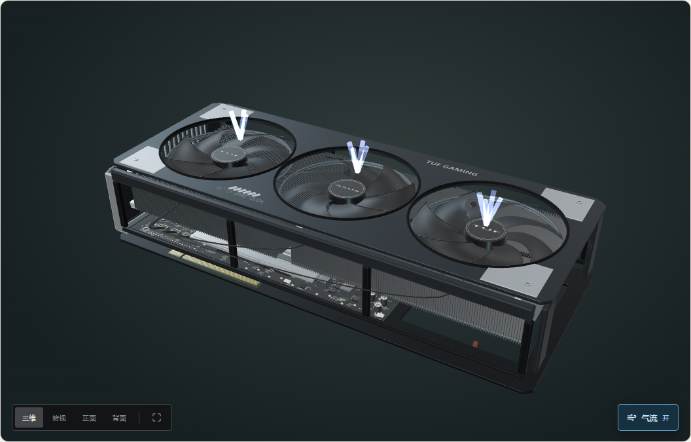

# 审查整改续篇：PS5、显卡包络与演示方式

接续 [原审查 R01–R40](MODEL-REVIEW-2026-10-19.md) 和 [动力整改](POWERTRAIN-REBUILD.md)。本页记录新增修改，不将尚未复核的设备标记为完成。

## PS5 电源：R17

对照 [iFixit 原版 PS5 拆解第 10 步](https://www.ifixit.com/Teardown/PlayStation+5+Teardown/138280)，将规则盒体改为折转、收窄的靴形壳体。下壳、上盖、PCB 和绝缘片共用轮廓；内腔、侧壁贯穿通风孔和四个带孔支承柱分别建模。支承柱顶面接触 PCB 底面。

两只大电容改为卧式排列；输入滤波和次级元件安装在公共 PCB 上，取消虚构的功能小板。窄端增加输出接触座。上盖先抬起再侧移，板上元件随后抬过壳体再分开；页面说明后半段属于去焊示意。

**局部装配关系与轮廓已修正，R17 仍部分待核。** 内部尺寸为照片重建；尚无对应 Delta 料号的完整板图、BOM 与测绘。整机主板直插接点和电源座还需联合定位，不能宣称型号级复原完成。

## PS5 散热器：R18

单一片堆改为三个错位鳍片区，共 94 片带折角的薄片。六条连续铜管从接触区转向片堆，穿管孔直接取自同一组管路曲线。中央管路采用分层避让，修复了首次检测发现的管管相交。

底板、铜管、鳍片和固定耳在 0–70% 保持焊接总成关系，100% 才独立排布。液金周边增加有中央窗口的绝缘泡棉。子层级增加四个观察节点，区分总成、围护、导热路径和清单。

**片管相交与不真实滑拆已修正，R18 仍部分待核。** 原厂片数、具体弯管、压紧机构仍未完整复原；94 片是模型绘制数量，不是 Sony 公布的 BOM。

## TUF RTX 5090：R10

[ASUS 官方规格](https://www.asus.com/uk/motherboards-components/graphics-cards/tuf-gaming/tuf-rtx5090-32g-gaming/techspec/)为 348 × 146 × 72 mm。旧代码的 68 mm 是 PCB 到上罩的基准距离，叠加上罩和背板后实体厚度约为 **77.24 mm**。

现在从 72 mm 扣除背板和上罩凸起设置装配基准，同步更新电机、螺钉与线缆端点；侧边文字平面也缩至边条以内。测试测量最终网格：厚度误差小于 0.1 mm，长宽允许约 1 mm 倒角偏差。支架凸耳与 PCIe 金手指单列检查；气流箭头不计为实体。

**实体厚度验收完成；R10 的完整板形、插座和支架照片验收仍待补。** 几何尺寸一致不能证明内部 PCB 已达到工厂测绘精度。

## 演示方式：R35、R40

全部 **78 个实体层级**显式归类为总成拆解、内部剖分、粘接结构、制造分解、焊接总成或原理模型；逻辑层级说明方块不是实际芯片版图。100% 清单说明位置不代表装配和拆卸运动。

类型在标题旁显示，可展开说明，手机保留入口。PS5、一体气缸、定子、教学镜头与通用动圈单元有单独边界说明。全站类型标注已完成；其余设备的排线依赖、粘接和连续路径仍须逐个验证，没有用说明代替几何整改。

## 验证

- 全量 **180 / 180** 通过。新增 8 项回归，包含最终显卡包络、PS5 通风孔、板柱接触、卧式电容、564 组片管曲面组合、15 组管管组合和全站分类。
- 类型、lint、构建和体积预算通过；入口 **72.9 KiB gzip / 220 KiB**。三维资源块仍有体积提示，未放宽限制。
- 有效性审计：**116 层、348 姿态、3245 件**，只证明目录与有限包络，不证明全站任意姿态无相交。
- PS5、电源、散热、显卡、台式机各 0/25/50/100%，加两个手机视图，共 22 个生产预览状态，无页面异常；最终另复核 5 个界面状态，检查说明展开、标题分隔与窄屏边界。
- 当前目录：10 台设备、116 层、1228 条资料；资料条数不是完整 BOM 数量。

机器记录见 [验收数据](review-continuation-validation.json)。

已推送 GitHub 并部署至 [正式站点](https://zero-point-hardware-lab.vercel.app/)。线上再核查电源、散热器、显卡及 390 px 散热视图共 4 个状态，确认新节点与演示类型已上线，无页面异常。

## 仍未关闭

| 范围 | 待完善内容 |
| --- | --- |
| PS5 | 电源与主板接点共同定位；原厂弯管、压紧件；风扇和光驱版本 |
| iPhone 15 | 排线、连接器罩、胶层及解除连接后再移动的完整依赖 |
| Sony α7 IV | 机壳逐面特征、IBIS 支承、快门驱动；镜头保留教学处方标签 |
| DualSense | 固定 BDM 修订版支架、扳机、左右机构和线束照片对应 |
| AirPods Pro 2 | 左右非对称、泄压口、声道、柔性板；通用单元不冒充原厂 |
| Legion / MacBook | FRU、板件、电池配置；支架、天线、绝缘和排线 |
| 台式机 | 实板正反面对应、显卡板形与端口全项验收、类别模型 SKU 范围 |
| 动力 | 四冲程联动、化油器与调速；电机相接线、磁钢分段和轴承型号 |
| 共性 | 逐件中文说明、其余设备连续运动检查、真实低配设备帧时 |

## 实际渲染

[390 px PS5 散热](screenshots/review-ps5-cooling-mobile.png)
